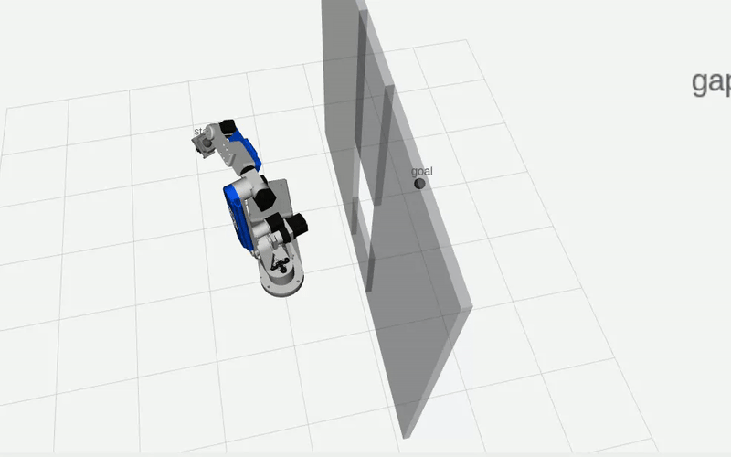
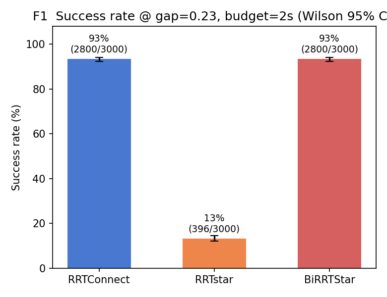
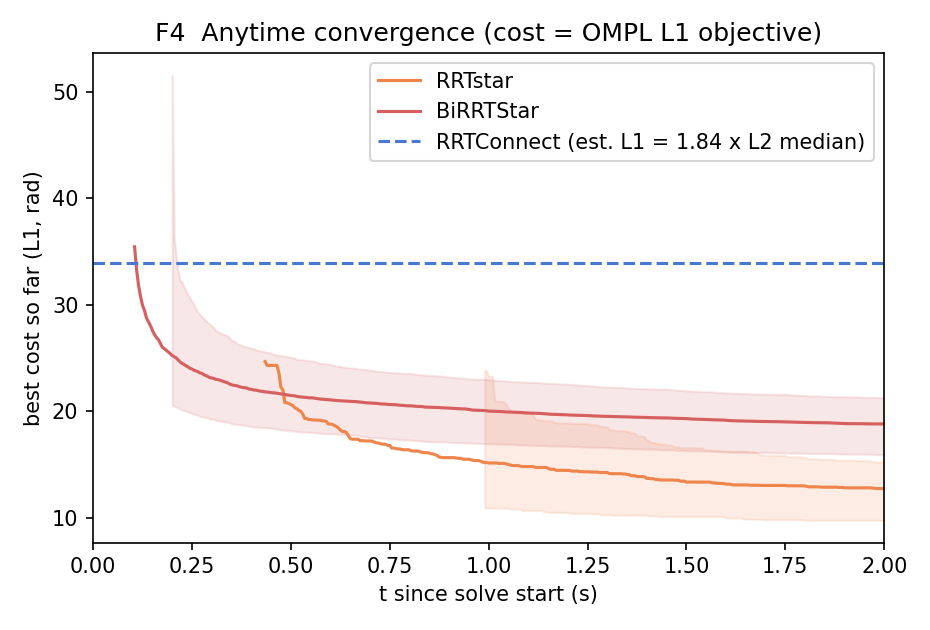
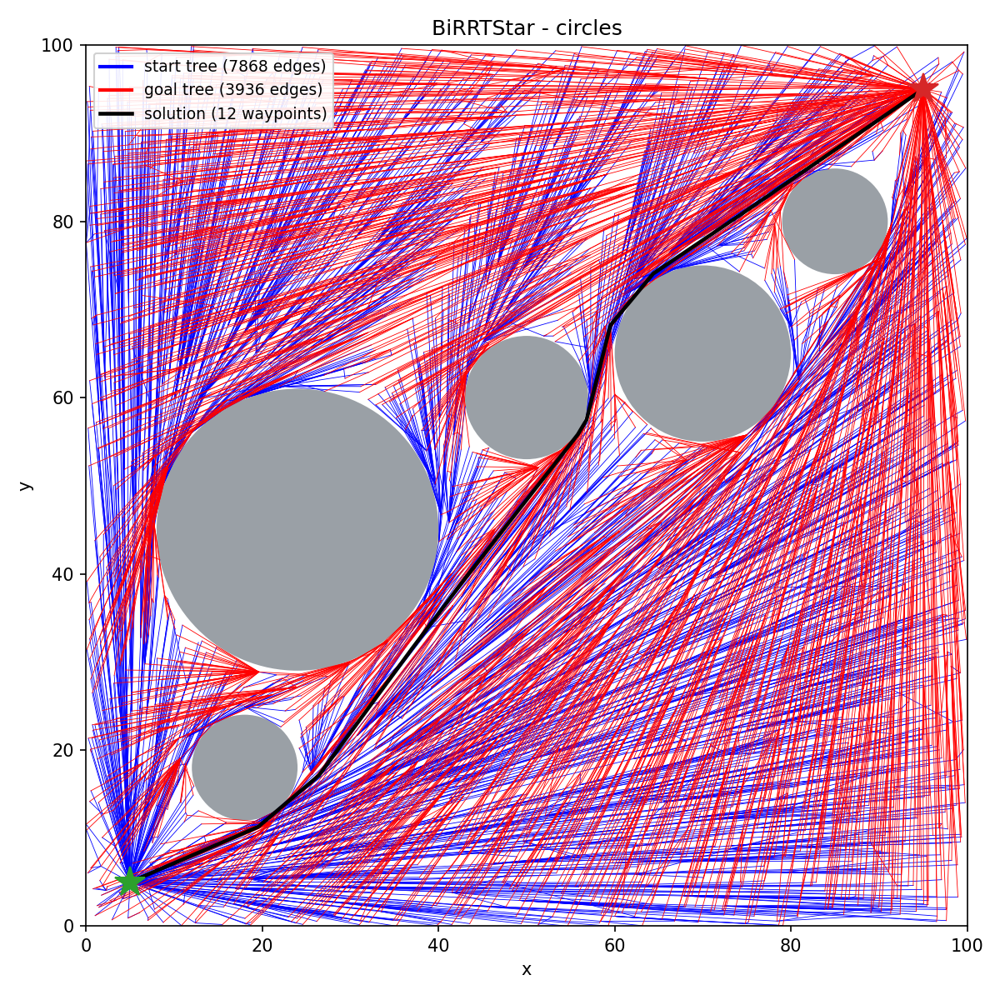
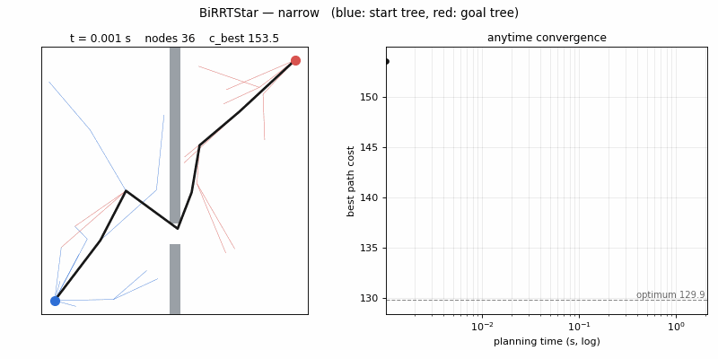

# BiRRTStar：六轴机械臂的双向渐近最优运动规划

> 用 C++ 自研双向渐近最优规划器 **BiRRTStar**，封装为 MoveIt 2 插件；
> 并搭建一台可复现的窄通道 benchmark，用统计方法回答"它比基线好在哪、代价是什么"。

**ROS 2 Jazzy** · **MoveIt 2.12** · **OMPL 1.7** · **C++17 / Python** · AR4 MK4 六轴机械臂 · 纯仿真

<!--
  演示动画预留位：录好后放到 media/demo.gif，删掉下面的占位引用块，取消 <p> 的注释即可。
  建议内容：RViz 中机械臂穿过墙洞，左右并排对比 RRTConnect 与 BiRRTStar 的轨迹。
<p align="center">
  
</p>
-->
> RViz 中 AR4 穿过 0.23 m 墙洞，RRTConnect 与 BiRRTStar 轨迹并排对比。


## 一眼看结果

窄通道 gap = 0.23 m，三种算法使用同一适配层、同一题目集，2.0 s 预算，每种各规划 3000 次，均不经路径简化：

| | RRTConnect | RRTstar | **BiRRTStar（本项目）** |
|---|---|---|---|
| 成功率（Wilson 95% CI） | 93.3% [92.4, 94.2] | 13.2% [12.0, 14.5] | **93.3%** [92.4, 94.2] |
| 首解时间中位数 | 0.054 s | 0.427 s | **0.100 s** |
| 路径长度中位数 | 18.43 | 6.98 \* | **10.23（−44%）** |

<sub>\* RRTstar 只有 396 个成功样本，属于幸存者子集，路径长度不能直接比较。gap = 0.36 m 档复现了同样的结论。</sub>

**结论**：BiRRTStar 的首解时间约为 RRTConnect 的 2 倍，换来**相同的成功率**和**短 44% 的路径**；
与单向 RRT\* 相比，成功率高 80 个百分点，首解快约 4 倍。

<p align="center">
  
  
</p>

## 亮点

- **算法**：以 RRTConnect 的双树和贪心连接为骨架，移植 RRT\* 的 cost-to-come、chooseParent、rewire 机制。
  算法层零 ROS 依赖，二维验证程序与六维 MoveIt 插件共用同一份代码（[§7](#7-算法选型说明不是组装是移植)）。
- **测试台**：以墙洞宽度作为唯一难度变量，题目集经三层过滤保证档档有解；
  CSV 接口契约加配置指纹，支持断点续跑，新增算法不用改分析脚本（[§1](#1-这个项目在做什么)）。
- **方法论**：排查出默认后处理造成的 928 次假失败，用配对比较剥离幸存者偏差，
  用中间解回调提取首解时间与收敛曲线（[§5](#5-值得单独说的六个技术点)）。

**目录**：[做什么](#1-这个项目在做什么) · [核心结果](#2-核心结果) · [快速开始](#3-快速开始) · [项目结构](#4-项目结构) · [技术点](#5-值得单独说的六个技术点) · [已知限制](#6-已知限制) · [算法选型](#7-算法选型说明不是组装是移植) · [路线图](#9-路线图)

---

## 1. 这个项目在做什么

绝大多数"我实现了 RRT\*"的项目，最后只能给出一张截图和一句"跑通了"。
这个项目的核心资产不是某个算法，而是**一台可复用的评测装置**：

```
        固定不动（测试台）                        可替换
   ┌────────────────────────────────┐      ┌──────────────────┐
   │ 场景       6 档 gap 的窄通道墙  │      │                  │
   │ 题目集     60 个 (start, goal) │─────▶│    某个算法      │
   │            已预筛，档档有解     │      │                  │
   │ 机器人     AR4 MK4 + 夹爪      │      └────────┬─────────┘
   │ 碰撞分辨率 lvsf = 0.005        │               │
   │ 后处理     只留 ValidateSolution│              ▼
   └────────────────────────────────┘        同一张 9 列 CSV
                                                    │
                                          s3_analyze.py 统一出表出图
```

**接口契约**：任何新算法的产出必须是同样的 CSV（`bench/s3_runner.py::CSV_FIELDS`）。
满足它，分析脚本一行不改就能把新算法画进同一张对比图。
守住契约，**"加一个算法 = 加一条线"** 就是真的。

场景本身也很干净：机器人正前方一堵比臂展更宽、更高、落到地面的墙，墙上开一个宽 `w` 的方洞。
绕不过、翻不过、钻不过——唯一通路是那个洞。`w` 是**唯一自变量**。

---

## 2. 核心结果

### 2.1 难度旋钮有效：双向搜索的优势随通道收窄单调放大

Stage 0，官方 OMPL 管线，6 档 × 60 题 × 5 次，2.8 s 超时：

| gap (m) | RRTConnect | RRT | 差值 |
|---|---|---|---|
| 0.450 | 100.0% | 94.0% | +6.0 |
| 0.360 | 100.0% | 91.7% | +8.3 |
| 0.290 | 99.7% | 84.0% | +15.7 |
| 0.230 | 99.7% | 69.0% | +30.7 |
| 0.180 | 99.7% | 45.3% | +54.4 |
| 0.150 | **98.3%** | **26.0%** | **+72.3** |

单向 RRT 在 `w=0.18` 跌破 50%，`w=0.15` 只剩 26%；RRTConnect 全程 ≥98%。
**所有题在所有档位都确定有解**（三层过滤保证），所以失败一律是"2.8 s 内没找到"，不是"无解"。

### 2.2 自研 BiRRTStar：零可靠性代价换来质量提升

Phase D 定点实验，**三算法同一适配层、同一题目集、同一 2.0 s 预算**，各 3000 次：

| 指标 | RRTConnect | RRTstar | **BiRRTStar** |
|---|---|---|---|
| 成功率 (Wilson 95% CI) | 93.3% [92.4, 94.2] | 13.2% [12.0, 14.5] | **93.3%** [92.4, 94.2] |
| 首解时间中位 (p95) | 0.054 s (0.157) | 0.427 s (1.794) | **0.100 s** (0.419) |
| 路径长度中位 (L2) | 18.43 | 6.98 \* | **10.23** |
| 最终 cost (L1) | 33.9 † | 12.74 \* | **18.80** |

*gap = 0.23 m。* `*` RRTstar 仅 396 个成功样本，属幸存者子集，质量指标不可直接比较。
`†` RRTConnect 的 L1 参考线由 L1/L2 比值换算，为估计值。

三点结论：

1. **可靠性**：BiRRTStar 与 RRTConnect 成功数逐字相同（2800/3000，CI 完全重合）
   —— 双树扩展 + rewiring 的额外开销**没有损失任何找解可靠性**。
2. **首解代价**：2 倍于 RRTConnect，但比单向 RRTstar **快 4 倍**，p95 只有 0.419 s。
3. **质量**：同预算下最终路径比 RRTConnect **短 44%**，且 F4 收敛曲线显示
   它在 ~0.25 s 即过半数解出，随后 23.96 → 18.80（−21%）持续收敛。

`gap = 0.36` 复现了全部结论（首解差距收窄到 1.4 倍，质量优势仍是 45%）。

### 2.3 一个反直觉的对照

在 `gap=0.36` 上补做的管线对照实验显示：**官方 OMPL 管线的单向规划器为 69.0%，
而自研适配层的真 RRTstar 只有 33.3%**。这个差距主要来自算法本身
（官方配置的 `geometric::RRT` 带 0.05 goal bias，真 RRTstar 没有），
提示"单向树在窄通道下的 goal 侧采样饥饿"是结构性问题，而非适配层伪现象。

---

## 3. 快速开始

### 依赖

```bash
# ROS 2 Jazzy (Ubuntu 24.04) + MoveIt 2
sudo apt install ros-jazzy-moveit ros-jazzy-ros2-control ros-jazzy-ros2-controllers
```

### 构建

```bash
cd ros2_robot_s
colcon build --packages-select ar4_my_planners
source install/setup.bash
```

### 跑一次完整的 benchmark

```bash
cd bench

# 终端 1 —— move_group。务必 tee 落盘：首解时间与收敛事件流都在日志里
ros2 launch ./bench.launch.py 2>&1 | tee /tmp/move_group.log

# 终端 2
python3 s3_scene.py --clear                                  # 清场景
python3 s3_queries.py --samples 20000 --near-rate 0.15       # 生成候选题目
python3 s3_runner.py --prescreen --max-queries 60            # 预筛出确定有解的题
python3 s3_runner.py --gaps 0.23 --reps 50 --out s3_phaseD.csv   # 正式实验（可 Ctrl-C 续跑）

# 分析
python3 s3_extract_events.py --log /tmp/move_group.log \
                             --csv s3_phaseD.csv --out-prefix s3_phaseD
python3 s3_plot_phaseD.py --prefix s3_phaseD --gap 0.23
python3 s3_analyze.py --csv s3_phaseD.csv                    # 通用表（成功率 + 配对比较）
```

> ⚠️ **不要用 `demo.launch.py`** —— 它开着路径简化，会污染结果（见 §5.2 与 §5.5）。
> 用 `bench/bench.launch.py`。

### 单独验证算法内核（不依赖 ROS）

```bash
./build/ar4_my_planners/birrtstar_2d narrow 2.0 /tmp
python3 bench/plot_birrtstar_trees.py narrow /tmp
```

二维 harness 带自检（返回精确解 / 路径不穿障碍 / 端点正确 / 代价一致 / `c_best` 严格递减），
并导出两棵树与最终路径的可视化——**调 rewiring 时，看到树就知道错在哪。**

---

## 4. 项目结构

```
ros2_robot_s/
├── src/
│   ├── ar4_my_planners/          ★ 本项目的全部原创代码
│   │   ├── include/ar4_my_planners/
│   │   │   ├── birrtstar.hpp         算法接口（零 ROS 依赖）
│   │   │   ├── planner_manager.hpp   pluginlib 入口
│   │   │   └── planning_context.hpp  单次规划
│   │   └── src/
│   │       ├── birrtstar.cpp         BiRRTStar 实现（695 行）
│   │       ├── birrtstar_2d.cpp      二维独立验证程序（301 行）
│   │       ├── planner_manager.cpp
│   │       └── planning_context.cpp  MoveIt ↔ OMPL 适配层
│   └── annin_ar4_*/              AR4 驱动 / 描述 / Gazebo / MoveIt 配置（第三方，见 §10）
├── bench/                        ★ 测试台（Python，约 2000 行）
│   ├── bench.launch.py               实验专用 launch（含四处关键覆盖）
│   ├── s3_scene.py                   窄通道场景 + S3Client 基础类
│   ├── s3_queries.py                 题目集生成（三层过滤）
│   ├── s3_runner.py                  预筛 + 正式实验 + 配置指纹
│   ├── s3_analyze.py                 通用分析（Wilson CI + 配对比较）
│   ├── s3_extract_events.py          从日志提取首解时间与收敛事件流
│   ├── s3_plot_phaseD.py             F1–F4 出图
│   ├── plot_birrtstar_trees.py       二维双树可视化
│   └── s3_*.png                      实验结果图（CSV/JSON 数据由上述脚本生成，不入库）
├── media/                        演示动画（待补充）
└── LICENSE-AR4                   AR4 第三方包的 MIT 许可
```

---

## 5. 值得单独说的六个技术点

### 5.1 `success` 的定义，以及 928 次假失败

这是项目踩过最大的坑。`success` 不是"整条 MoveIt 流水线跑通了"，而是：

> **success = OMPL 找到一条路径，且该路径通过独立的碰撞复检**

因为默认流水线里有两个东西会污染结果：

- **`PathSimplifier`（`simplify_solutions`，默认开）**：把裸 RRT 和 RRTConnect 的路径一起捋平
  （实测 6.07 vs 6.29，毫无区分度——测到的是简化器的能力）；更糟的是 shortcutting
  把路径压向障碍边界，简化时判合法、`ValidateSolution` 换个分辨率复检就判非法。
- **`AddTimeOptimalParameterization`（TOTG）**：算不出时间参数时写 `error_code = 99999`，
  混进"规划失败"。

初版实验因此产生 **928 次假失败**。诊断判据是**失败耗时分布**：

| 失败耗时 | 含义 |
|---|---|
| 接近超时值 | 真的搜不到——算法难度，结论成立 |
| **≈ 成功耗时，且从不超时** | **路径找到了，被后处理毙了——测的不是规划** |

928 次全部落在第二类。**先跑 `gap=0.45`（洞 450 mm，本该全过）做 sanity check**，
修前只有 72%，这就是流水线有问题的明确信号。修复后 RRTConnect 在该档回到 100%。

### 5.2 三层过滤，让成功率的分母变干净

| 层 | 排除的东西 | 不做会怎样 |
|---|---|---|
| 强制 start 在近侧 → goal 在远侧 | 不用穿墙的题 | 远侧构型只占 ~5%，随机配对下 90% 的题不碰墙，成功率曲线是平的 |
| 取各档端点可行集的**交集** | 端点本身碰墙的题；各档题目集不一致 | "失败"里混着"这题没有起点"；且 `w` 变时题目集也在变，两个变量纠缠 |
| 在最窄档做存在性预筛 | 确实无解的题 | 分母不干净 |

利用**自由区随 `w` 严格单调增**这一性质：最窄档有解 ⇒ 所有档位都有解，
所以预筛只需在最窄档跑一次，省掉 5/6 开销。

做完之后成功率的含义是干净的：**在已知有解的问题上，算法能在 T 秒内找到解的比例**。

### 5.3 幸存者偏差必须用配对比较剥离

主表里的路径长度**不能直接横向比**：`w=0.15` 时 RRT 只成功 26%，
那 26% 是树恰好朝目标长过去的"顺利"样本，真正要绕远的难题被算作失败、不进统计。

正确做法是**只取两个 planner 都成功过的 query** 逐题配对：

| gap | 配对数 | 弃用 | RRTConnect | RRT | 比值 |
|---|---|---|---|---|---|
| 0.450 | 60 | 0 | 7.19 | 6.38 | 1.037 |
| 0.150 | 38 | **22** | 8.04 | 6.26 | **1.186** |

「弃用」列 0→0→0→3→9→22 随难度单调上升，**这就是幸存者偏差的直接测量**。
并且可以定量剥离：`w=0.15` 时朴素比较为 8.43/6.39 = 1.32，配对后为 1.186
——表观差异中约 1.11× 来自偏差，剩余 1.186× 才是真实的。

### 5.4 距离度量：规划器优化 L1，CSV 报 L2

MoveIt 的 `JointModelStateSpace` 用的是**加权 L1**，不是 OMPL `RealVectorStateSpace` 的 L2。
实测探针（两个每维差 0.5 rad 的 state）：

```text
[dist-probe] type=JointModel dim=6 distance=3.0000 maxExtent=26.9304
```

`distance = 3.0`（L1 而非 L2 的 1.2247），`maxExtent = 26.93 rad`（六关节行程之和，L1 对角线）。

两个直接后果：

1. **规划器优化 L1，CSV 报 L2**——两者单调相关但不成比例，
   所以"RRT\* 明明在优化、L2 路径长度却没按比例下降"是预期内的，不是 bug。
2. **运动校验粒度差 2.45 倍**：`max_seg_len = lvsf × extent = 0.005 × 26.93 ≈ 0.135 rad`。
   若度量是 L2，extent 只有 11.79，粒度会细 2.3 倍。基线用同一个 state space，口径一致，不影响对比。

### 5.5 配置指纹——断点续跑的安全锁

第一轮真的踩过：改了机器人模型（摘夹爪）和 OMPL 配置之后直接续跑，
`done` 集合只按 `(gap, query_id, planner, rep)` 去重，浑然不知配置已变，
**一个 CSV 里混了两批不可比的数据**。

现在 `s3_runner.py` 把 `{has_gripper, planners, timeout, questions_sha1}` 写进 sidecar，
续跑前比对，不一致直接拒绝。其中 `has_gripper` **读自实际加载的 `/robot_description`**——
不看 launch 参数、不看用户声明，这是唯一可信的来源。

配套还有 `Runner.check_limits()`：开跑前把硬编码的关节限位和实际 URDF 逐关节比对。
采样箱一旦比真实可行域宽，越限的 start/goal 会被 `CheckStartStateBound` 静默处理，
症状只表现为"莫名其妙的失败"。

### 5.6 首解时间：为什么必须有，以及怎么拿

`RRTConnect` 找到第一条路径就返回；`RRTstar` 和 `BiRRTStar` 找到后**继续优化到预算耗尽**。
所以只记 `planning_time` 的后果是：三个算法里两个的时间列都是同一个常数（≈ timeout），
"哪个算法找解快"这个问题**根本没有数据支撑**。

解法是 OMPL 的**中间解回调**（`setIntermediateSolutionCallback`），它在 `solve()` 返回前触发：

- `RRTstar` / `BiRRTStar`：第一个事件的时刻 = 首解时间；
- `RRTConnect` 找到即停、不触发回调，首解时间 ≈ `planning_time`。

一个出口同时承担三件事：**首解时间戳、`c_best` 严格递减断言、anytime 收敛曲线的事件源**。
由于 `MotionPlanResponse` 没有 `t_first` 字段，实现上打日志、
分析期用 CSV 的 `t_request` 墙钟列与日志时间戳按时间窗对齐提取
（`s3_extract_events.py`）。

---

## 6. 已知限制

1. **`link_5` / `link_6` 没有碰撞几何。** 上游 URDF 引用的 `Link_5_Col.STL` /
   `Link_6_Col.STL` 在仓库里不存在，MoveIt 把这两个连杆的碰撞体置空。
   手腕那一段能无代价穿墙，末端难度实际由 `link_4` + 夹爪决定
   → **绝对成功率偏乐观，但 planner 之间的相对比较不受影响**
   （所有算法面对同一个机器人模型）。修复会改变碰撞几何、使第一轮数据作废。
2. **`collision_checks` 拿不到。** `/plan_kinematic_path` 不暴露 planner 内部计数。
   本轮只能用 `planning_time`，因此**必须固定机器、固定负载跑完整轮**，结果不可跨机器比较。
3. **随机种子控制不了。** `MotionPlanRequest` 没有 seed 字段，"5 个 seed" 实为 5 次独立重复。
   统计上等价，但单次结果不可精确复现。
4. **纯仿真。** 无实物机械臂，结论限于 `PlanningScene` + FCL 的碰撞模型，
   不含标定误差、控制误差、传感噪声。
5. **单场景。** 只有 S3 一类窄通道，结论不能外推到一般杂乱环境或高维冗余臂。
6. **`planning_time` 在失败时不可用。** MoveIt 只在成功分支给该字段赋值，
   搜索失败时保持默认 0。因此它只能用作机制判据（是否精确为 0），不能衡量搜索投入。
   → 这三条（2、3、6）正是自研插件的动机，自研 planner 能自己加计数器、自己传 seed。
7. **跨管线 `path_length` 不可比。** `mine`/RRTConnect 与官方 `ompl`/RRTConnect 存在
   未定位的 2.11× 系统性差异（56/56 query 无一例外）。根因已排除到源码级、
   探针方案已备，暂缓执行。**不影响 mine 内部三算法对比**（共享同一适配层，差异是共模的）。
8. **0.25% 的后处理拒绝未被消除**（9/3600），集中在 6 个 query 上，使成功率为略微保守的下界。

---

## 7. 算法选型说明（不是组装，是移植）

四份 OMPL 参考实现的 "cost" 不是同一个东西：

| | 树 | `Motion::cost` 是什么 | chooseParent | rewire | 渐近最优 |
|---|---|---|---|---|---|
| `RRTstar` | 单 | cost-to-come | ✅ | ✅ | ✅ |
| `RRTConnect` | 双 | 无 cost 字段 | ❌ | ❌ | ❌ |
| `BiTRRT` | 双 | `stateCost`（单点代价，不累积） | ❌ | ❌ | ❌ |
| `STRRTstar` | 双 | 无 cost 字段，"代价"是 root 的时间分量 | ❌ | 仅目标树 | ❌ |

**没有任何一份在做"双树 + cost-to-come + chooseParent + rewire"这件事**——
BiTRRT 和 STRRT\* 都是双树 + 有 `opt_`，但都没有 cost-to-come；RRT\* 是唯一有的，而它是单树。

所以 BiRRTStar 的设计定位是：

> **骨架取 RRTConnect**（双树 + `GrowState` + connect 贪心）、
> **函数拆分取 BiTRRT**（`addMotion`/`extendTree`/`connectTrees`，`tree == tStart_` 推方向）、
> **代价机制取 RRTstar**（cost-to-come + chooseParent + rewire + `updateChildCosts`），
> 两棵树内部各自独立运行。

这是把 RRT\* 的代价机制**移植**到 RRTConnect 骨架上，不是组装现成件。
移植带来的三个开放风险（`connectionPoints_` 无界增长、REACHED 重复节点、
渐近最优性无背书）均已逐条分析并给出规避方案。

**算法层零 ROS/MoveIt 依赖**——只依赖 `ompl::base` / `ompl::geometric` / `ompl::datastructures`，
在 CMake 里做成独立 STATIC target 从构建系统层面强制隔离。
因此二维 harness（Phase B）与六维 MoveIt 插件（Phase C）**共用同一份算法代码**，
从二维到六维只替换 state space、validity checker 和 start/goal，算法一字不改。




---

## 8. 技术栈

| 层 | 内容 |
|---|---|
| 中间件 | ROS 2 Jazzy（Ubuntu 24.04） |
| 规划框架 | MoveIt 2.12.4——自定义 `PlannerManager` / `PlanningContext` 插件（pluginlib） |
| 采样规划库 | OMPL 1.7（`ompl::base` / `geometric` / `datastructures`，`NearestNeighborsGNAT`） |
| 语言 | C++17（算法与插件）、Python 3.12（测试台） |
| 数据与统计 | CSV 契约、Wilson 95% 置信区间、配对比较、日志事件流对齐 |
| 硬件 | ThinkPad T470p / Intel i5-7300HQ（`planning_time` 与此强相关） |

---

## 9. 路线图

```
   Stage 0  S3 测试台 + OMPL 基线              ✅ 已完成
   Stage 1  自研 RRT / RRT* / BiRRTStar        ✅ 主体完成（Phase A–D 已跑）
            封装为 MoveIt 插件
   Stage 2  （已并入 Stage 1）
   Stage 3  解析 IK（Pieper）替换 KDL          ⏳
   Stage 4  带碰撞代价的轨迹优化                ⏳
   Stage 5  学习式采样器（GMM / 小 MLP）        ⏳
```

近期未完成项：预算扫描（0.2/0.5/1.0/2.0 s 下 BiRRTStar 是否仍保 93% 成功率）、
六维 k-nearest 开销与 REACHED 重复率量化、问题 #1 根因探针。

---

## 10. 第三方代码与许可

`src/annin_ar4_*` 来自开源的 AR4 机械臂 ROS 2 驱动（MIT 许可，原版权声明见 [LICENSE-AR4](LICENSE-AR4)），
提供机器人描述、驱动、Gazebo 与 MoveIt 配置。本项目对其只有一处改动：
`annin_ar4_moveit_config/launch/demo.launch.py` 中用 `ParameterValue(..., value_type=str)`
包裹 `robot_description` / `robot_description_semantic`，以兼容 Jazzy 的参数类型推断。

所有实验配置集中在 `bench/bench.launch.py` 的内存覆盖里，
所以改参数不需要 `colcon build`，而且"这次实验到底用了什么设置"在一个地方就能看全。

`src/ar4_my_planners/` 与 `bench/` 为本项目原创。
